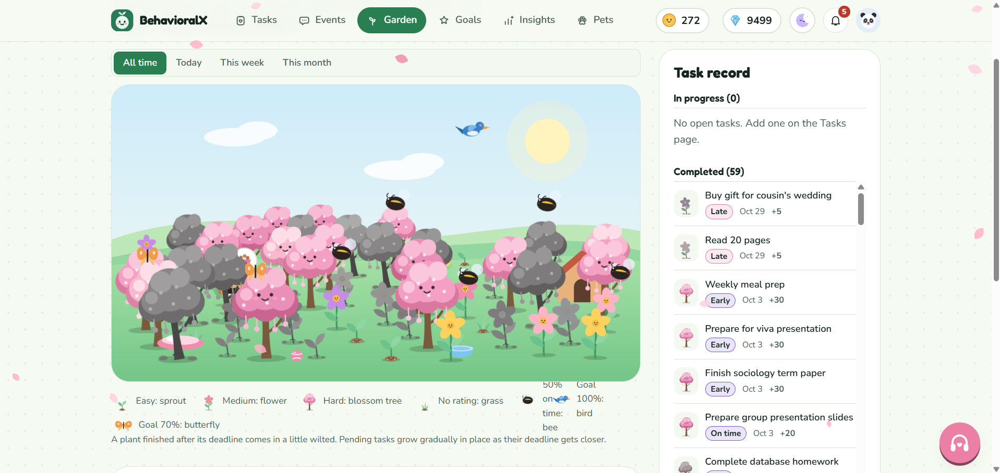
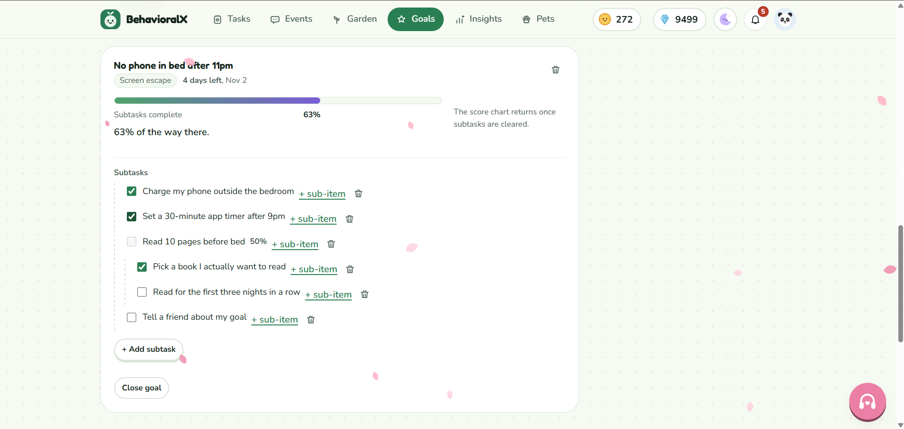
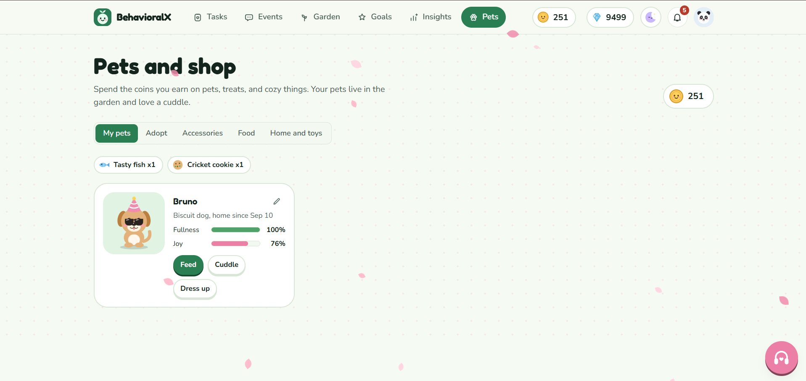

# BehavioralX

A gamified behaviour-tracking web app built on a **MySQL 8** relational database with a **PHP** backend and a **JavaScript** frontend. Users log tasks and behaviour events, set goals to change habits, and are rewarded with a growing garden, pets, coins and diamonds.

> Database Management Systems (DBMS) course project.

## Features

- **Tasks:** finished tasks grow plants in a virtual garden
- **Events:** log behaviour as *context → trigger → behaviour → decision → outcome*, with alternatives considered and reflection notes
- **Patterns:** events and habit tasks are analysed and counted under behaviour patterns, with a 30-day strength view
- **Goals:** set a baseline and target for a behaviour, with weekly automatic check-ins, subtasks and progress tracking
- **Rewards and shop:** earn coins and diamonds, adopt pets, buy accessories, food, home items and garden seasons
- **Profile and settings:** preset avatars, uploaded avatars, sound, music and theme preferences
- **Notifications** and a wallet with a full transaction history

## Database Design

The schema is in [`database/behavioralx.sql`](database/behavioralx.sql).

- **27 tables** grouped into: catalogue tables (`avatars`, `seasons`, `pet_kinds`, `pet_variants`, `accessories`, `foods`, `home_items`), users (`users`, `user_settings`, `user_seasons`), tasks, goals (`goals`, `goal_checkins`, `goal_subtasks`), events (`events`, `event_alternatives`, `event_notes`, `event_patterns`, `task_patterns`), economy (`coin_transactions`, `diamond_transactions`), pets and inventory (`pets`, `user_accessories`, `user_food`, `user_home_items`, `garden_decorations`) and `notifications`
- **4 views:** `v_user_balances`, `v_events_last_30_days`, `v_pattern_strength_30d`, `v_goal_progress`
- Primary and foreign keys, with seed data for the shop catalogue and demo data for one account

## Tech Stack

| Layer | Technology |
|---|---|
| Database | MySQL 8 |
| Backend | PHP (PDO), JSON API |
| Frontend | HTML, CSS, vanilla JavaScript |
| Security | Session cookies, CSRF token checks, prepared statements, locked-down upload folder |

## Screenshots

<!-- Add screenshots to an images/ folder and update these file names -->
| Garden | Goals | Shop |
|---|---|---|
|  |  |  |

## Project Structure

```
├── app/
│   ├── config.php        Database settings (reads environment variables)
│   ├── lib.php           Shared helpers: database, session, CSRF
│   ├── rules.php         Reward and game rules
│   ├── patterns.php      Pattern detection rules
│   ├── goals_lib.php     Goal calculations
│   ├── routes/           API routes: auth, tasks, events, goals, shop, profile, ...
│   └── tools/            CLI tools (recalc_patterns.php)
├── database/
│   └── behavioralx.sql   Schema, views, seed data and demo data
├── public/               Web root
│   ├── index.html        Single-page app
│   ├── api/index.php     API entry point
│   ├── assets/           JavaScript and CSS
│   └── uploads/avatars/  User-uploaded avatars
├── deploy/               nginx configuration for the avatar folder
└── tests/                UI test scripts
```

## Getting Started

### Prerequisites
- PHP 8 or newer
- MySQL 8 (XAMPP works)

### Installation
1. Clone or download this repository.
2. Import the database. This **drops and recreates** a database called `behavioralx`:
   ```
   mysql -u root -p < database/behavioralx.sql
   ```
   Or import `database/behavioralx.sql` in phpMyAdmin.
3. Check the database settings in `app/config.php`. The defaults are `127.0.0.1`, database `behavioralx`, user `root`, empty password. You can override them with the environment variables `BX_DSN`, `BX_USER` and `BX_PASS`.
4. Serve the **`public/`** folder:
   - Quick option: `php -S localhost:8000 -t public`, then open `http://localhost:8000`
   - XAMPP option: put the project in `htdocs` and open `http://localhost/<folder-name>/public/`

### Demo account
`database.sql` creates one demo account:

| Email | Username | Password |
|---|---|---|
| `maryum@example.com` | `Maryum` | `123456` |

### Recalculating patterns
After changing a pattern rule in `app/patterns.php`:
```
php app/tools/recalc_patterns.php
```

## Team

- My Name: Eusa Anjum Himel
- Teammate Name: 1/ Faija Ahamed Mim  2/ Maryum Binte Hossain

## License

This project was created for educational purposes.
